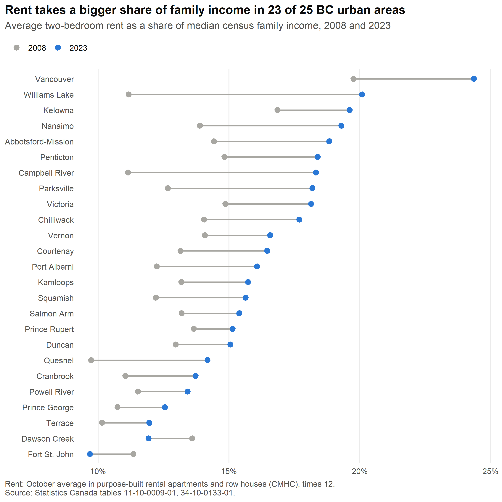
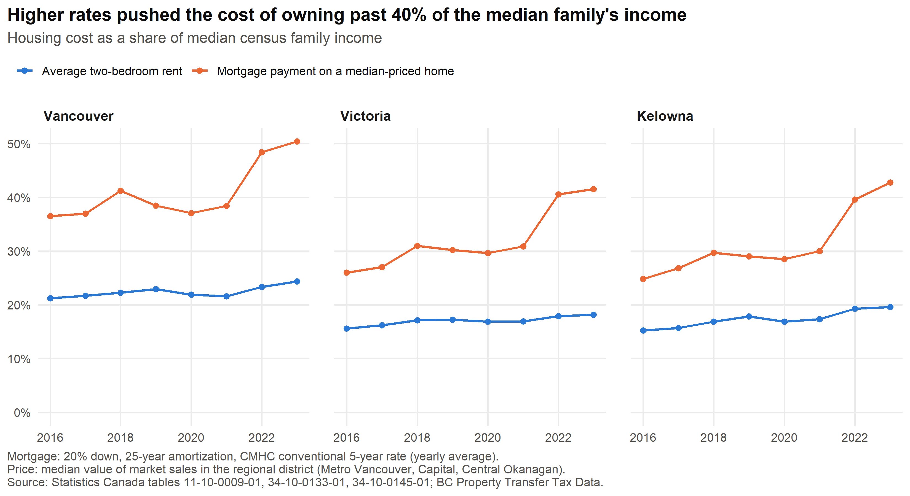
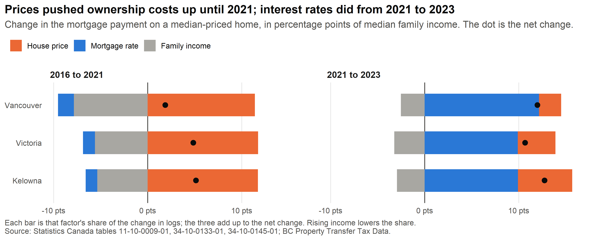

# Rent and mortgage burden in BC cities

How much of a typical family's income goes to rent, or to a mortgage, in British Columbia's cities? This R script works it out from open data alone.

> **Personal project.** This is my own analysis of publicly available data. It is not associated with my work for any current or past employer and does not represent their views.







## What it measures

**Rent-to-income** (25 census metropolitan areas and agglomerations, 2008 onward):

> 12 × average two-bedroom rent ÷ median total income of census families

**Ownership cost-to-income** (Vancouver, Victoria and Kelowna, 2016 onward):

> 12 × monthly mortgage payment ÷ median total income of census families

The mortgage is 80% of the median sale price (20% down), amortized over 25 years at that year's average 5-year conventional rate, with Canadian semi-annual compounding. Rent ratios start in 2008, the first year with income data for every smaller city. Ownership ratios start in 2016, when the property transfer data begin.

**What drove the change in ownership cost.** The ownership ratio is proportional to price × payment factor(rate) ÷ income, so its change in logs splits exactly into a house-price, a mortgage-rate and an income part. Each part's share of the log change is applied to the change in percentage points, so the three bars add up to the net change.

The full table is written to [`output/affordability_index.csv`](output/affordability_index.csv).

## What it shows (2023 data)

- Rent takes a bigger share of the median family's income than in 2008 in 23 of 25 areas. Vancouver is highest at 24%, up from 20%. Only Fort St. John and Dawson Creek moved the other way.
- Owning was already more expensive than renting, and the 2022–2023 rate increases widened the gap: the payment on a median-priced home went from about 38% to 50% of the median family's income in Vancouver, and from about 30% to over 40% in Victoria and Kelowna.
- The two periods had different causes. From 2016 to 2021, higher prices added 11 to 12 points in all three cities, and rising incomes took back half to two thirds of that. From 2021 to 2023, higher mortgage rates added 10 to 12 points, most of the rise in each city.

## Limits

- Income is for all families, not renters or buyers. Renter families typically earn less than the median, so their actual rent burden is higher than shown. Single people are not in the measure at all.
- Rents are what sitting tenants pay in purpose-built rental buildings (CMHC's October survey). Asking rents for vacant units, and rented condos or secondary suites, are often higher.
- Housing costs are partial. Rent may or may not include utilities. The ownership cost leaves out property tax, insurance, strata fees and maintenance, and ignores the hurdle of saving a down payment.
- Prices are approximate. The price is the median value of all market sales in the regional district (about 96% residential), and the annual figure is the sales-weighted average of the monthly medians. Metro Vancouver, Capital and Central Okanagan regional districts stand in for the Vancouver, Victoria and Kelowna metro areas.
- One rate for everyone. The 5-year conventional rate is a benchmark; borrowers' actual rates vary.
- Small markets are noisy. The rental survey covers few units in small cities, so their averages can swing from year to year (Williams Lake's 2023 jump is one example). Boundaries also differ slightly between the rent data (2011 census areas) and the income data (2016 and 2021 areas).
- Income data lag. Both series end with the latest year of family income data (2023), even though rents and prices are published sooner.

## Data

The script downloads everything itself:

| Data | Source | Licence |
|---|---|---|
| Median total income of census families | Statistics Canada, [table 11-10-0009-01](https://www150.statcan.gc.ca/t1/tbl1/en/tv.action?pid=1110000901) | [Statistics Canada Open Licence](https://www.statcan.gc.ca/en/terms-conditions/open-licence) |
| Average rents, two-bedroom units | CMHC Rental Market Survey, via Statistics Canada [table 34-10-0133-01](https://www150.statcan.gc.ca/t1/tbl1/en/tv.action?pid=3410013301) | [CMHC Licence Agreement for the Use of Data](https://www.cmhc-schl.gc.ca/about-us/terms-conditions/hmip-terms-conditions) |
| Conventional 5-year mortgage lending rate | CMHC, via Statistics Canada [table 34-10-0145-01](https://www150.statcan.gc.ca/t1/tbl1/en/tv.action?pid=3410014501) | [CMHC Licence Agreement for the Use of Data](https://www.cmhc-schl.gc.ca/about-us/terms-conditions/hmip-terms-conditions) |
| Median fair market value of property sales, by regional district | [BC Property Transfer Tax Data](https://catalogue.data.gov.bc.ca/dataset?q=%22property+transfer+tax+data%22), one dataset per year | [Open Government Licence – British Columbia](https://www2.gov.bc.ca/gov/content/data/policy-standards/open-data/open-government-licence-bc) |

Adapted from Statistics Canada, tables 11-10-0009-01, 34-10-0133-01 and 34-10-0145-01. This does not constitute an endorsement by Statistics Canada of this product.

Adapted from Canada Mortgage and Housing Corporation, Rental Market Survey average rents (October 2008–2023) and conventional 5-year mortgage lending rate (2008–2023). This does not constitute an endorsement by Canada Mortgage and Housing Corporation of this product.

Contains information licensed under the Open Government Licence – British Columbia.

## Run it

```r
install.packages(c("dplyr", "tidyr", "readr", "ggplot2", "jsonlite", "scales"))
source("code.R")
```

Run it from the repository folder (opening `bc_housing_affordability.Rproj` does this). It downloads about 4 MB and writes the charts to `figures/` and the table to `output/`. Statistics Canada's site is sometimes down for weekend maintenance; the script stops with a message if so.

## License

Code: [MIT](LICENSE).
